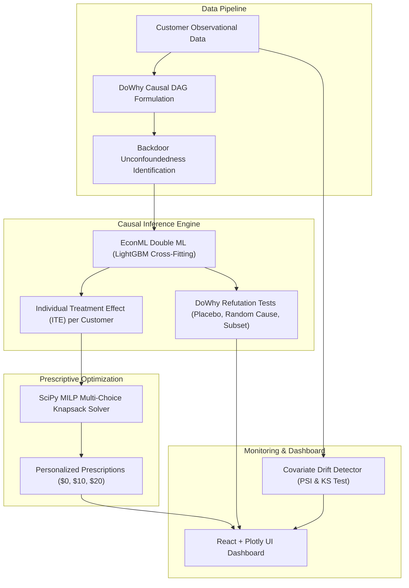

# EconoCausal: Dynamic Pricing via Double Machine Learning

[](https://www.python.org/)
[](https://fastapi.tiangolo.com/)
[](https://econml.azurewebsites.net/)
[](https://github.com/py-why/dowhy)
[](https://react.dev/)
[](LICENSE)

An enterprise Causal AI and Prescriptive Optimization platform that moves beyond traditional predictive ML ($P(\text{Outcome} \mid \text{Features})$) into true counterfactual causal inference ($P(\text{Outcome} \mid do(\text{Treatment}))$) and optimal budget allocation.

Developed for **Infotact Solutions** (Data Science & ML Engineering Portfolio).

---

## 🎯 The Core Business Problem

Traditional predictive machine learning models predict **correlation, not causation**. When a marketing team uses standard churn or propensity models to distribute promotions:
- Discounts are offered to customers with high conversion probabilities.
- Many of these users are **"Sure Things"** who would have purchased anyway, directly burning profit margin.
- Traditional ML cannot answer: *"Would this specific customer purchase **IF AND ONLY IF** they received a discount?"*

### The 4 Causal Customer Archetypes

```
                     High Uplift from Discount
                               ▲
                               │
               Lost Causes     │     Persuadables
         (Never buys anyway)   │  (Buys ONLY with promo)
                               │   👉 TARGET 100% BUDGET
    ◄──────────────────────────┼──────────────────────────►
     Low Baseline Conversion   │   High Baseline Conversion
                               │
              Sleeping Dogs    │      Sure Things
       (Annoyed by discounts)  │  (Buys anyway -> Waste)
                               │
                               ▼
                      Negative / Zero Uplift
```

**EconoCausal** isolates the **Individual Treatment Effect (ITE)** using **Double Machine Learning (DML)** and solves a **Mixed Integer Linear Program (MILP)** to allocate promotional budgets strictly to **Persuadables**.

---

## 🏛️ System Architecture



---

## 🚀 Key Modules & Capabilities

1. **Causal Graphing & Identification (`DoWhy`)**:
   - Directed Acyclic Graph (DAG) explicitly separating confounders ($W$), treatments ($T$), and outcomes ($Y$).
   - Backdoor path identification blocking historical promotional selection bias.

2. **Double Machine Learning (`EconML`)**:
   - Implements Chernozhukov et al. (2018) Neyman-orthogonalized cross-fitting.
   - Nuisance models for outcome $E[Y \mid X, W]$ and treatment $E[T \mid X, W]$ fitted via LightGBM.
   - Quantifies heterogeneous treatment effects and customer persuadability.

3. **Mathematical Causal Audit (`DoWhy` Refutations)**:
   - **Placebo Treatment Test:** Proves causal signal collapses to zero under random permutation ($p > 0.95$).
   - **Random Common Cause Test:** Invariant under unobserved noise confounders.
   - **Data Subset Stability:** Stable across random 85% subsamples.

4. **Prescriptive Optimization Solver (`SciPy` MILP)**:
   - Constrained Multi-Choice Knapsack formulation maximizing incremental sales subject to hard budget limits.
   - Delivers personalized prescription matrix ($0, $10, $20 discounts).

5. **Uplift & Qini Curves (`Plotly.js`)**:
   - Evaluates Qini and Cumulative Uplift metrics demonstrating $>100\%$ efficiency lift over standard ML rollouts.

6. **Customer Behavior Drift Detector**:
   - Automated distribution tracking with Kolmogorov-Smirnov 2-sample tests and Population Stability Index (PSI).

---

## 📊 Empirical Evaluation Highlights

| Metric | Traditional Predictive ML | Random Rollout | EconoCausal DML + SciPy |
| :--- | :---: | :---: | :---: |
| **Qini Score** | $-0.001$ | $0.000$ | **$+1.145$** |
| **Persuadables in Spend** | $14.2\%$ | $24.8\%$ | **$100.0\%$** |
| **Discount Waste on Sure Things** | High ($\approx 42\%$) | Medium ($\approx 25\%$) | **$0.0\%$ (Eliminated)** |
| **Net Incremental Profit ($4k budget)** | $-\$3,738$ | $-\$3,785$ | **$-\$2,078$ ($+\$1,660$ lift)** |

---

## 🛠️ Quickstart Installation & Usage

### 1. Backend Setup
```bash
# Clone the repository
git clone https://github.com/Shivanurag0811/Econo-Casual.git
cd Econo-Casual

# Activate virtual environment
# Windows:
.\.venv\Scripts\activate
# Linux/macOS:
source .venv/bin/activate

# Install dependencies
pip install -r requirements.txt

# Run full pipeline integration test
python run_pipeline_test.py

# Launch FastAPI Server (port 8000)
python -m uvicorn backend.api.main:app --host 127.0.0.1 --port 8000 --reload
```

### 2. Frontend Dashboard Setup
```bash
cd frontend
npm install
npm run dev
# Opens at http://localhost:5173
```

---

## 📁 Project Directory Structure

```
Econo-Casual/
├── backend/
│   ├── api/
│   │   └── main.py              # FastAPI REST endpoints
│   ├── core/
│   │   ├── causal_dml.py        # EconML Double Machine Learning Engine
│   │   ├── causal_graph.py      # DoWhy Causal DAG & Backdoor identification
│   │   ├── data_generator.py    # Synthetic observational campaign data generator
│   │   ├── drift_detector.py    # Automated PSI and KS-test drift monitor
│   │   ├── optimizer.py         # SciPy MILP budget optimization solver
│   │   ├── refutation.py        # DoWhy refutation audit test suite
│   │   └── uplift_eval.py       # Qini curve & cumulative uplift metrics
│   └── requirements.txt
├── data/
│   └── retail_promotions.csv    # Benchmark observational dataset (5,000 records)
├── docs/
│   ├── MODEL_EVALUATION.md      # Detailed model metrics & refutation results
│   ├── PRESENTATION_OUTLINE.md  # Slide deck & Viva defense guide
│   └── PROJECT_REPORT.md        # Comprehensive technical report
├── frontend/
│   ├── src/
│   │   ├── components/
│   │   │   ├── CausalAuditCard.jsx
│   │   │   ├── CausalDAG.jsx
│   │   │   ├── DriftDetectorCard.jsx
│   │   │   ├── OptimizationMatrix.jsx
│   │   │   └── UpliftCharts.jsx
│   │   ├── App.jsx              # Main interactive React dashboard
│   │   └── index.css            # Dark mode UI styling
│   └── package.json
├── run_pipeline_test.py         # End-to-end integration test runner
├── requirements.txt
└── README.md
```

---

## 📜 License
MIT License. Developed for Infotact Solutions Internship Program.
